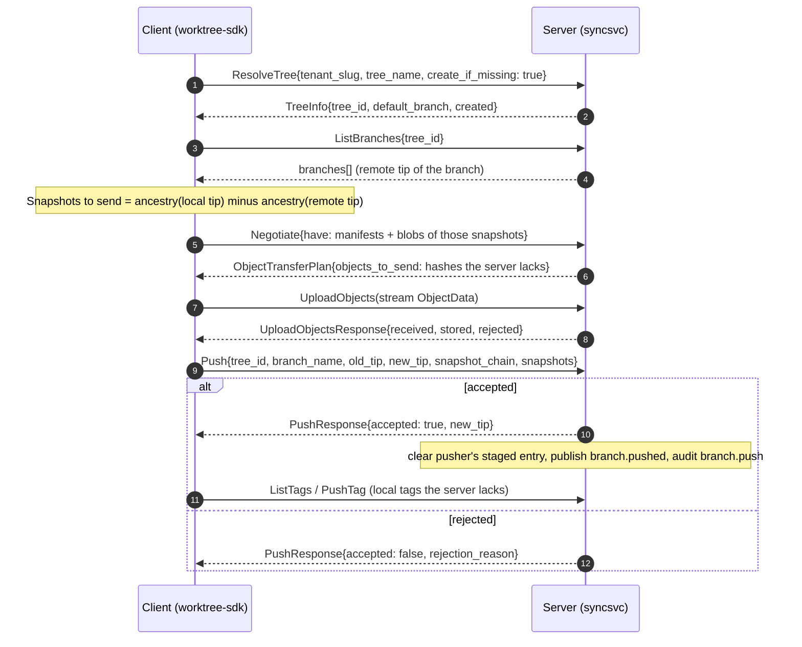
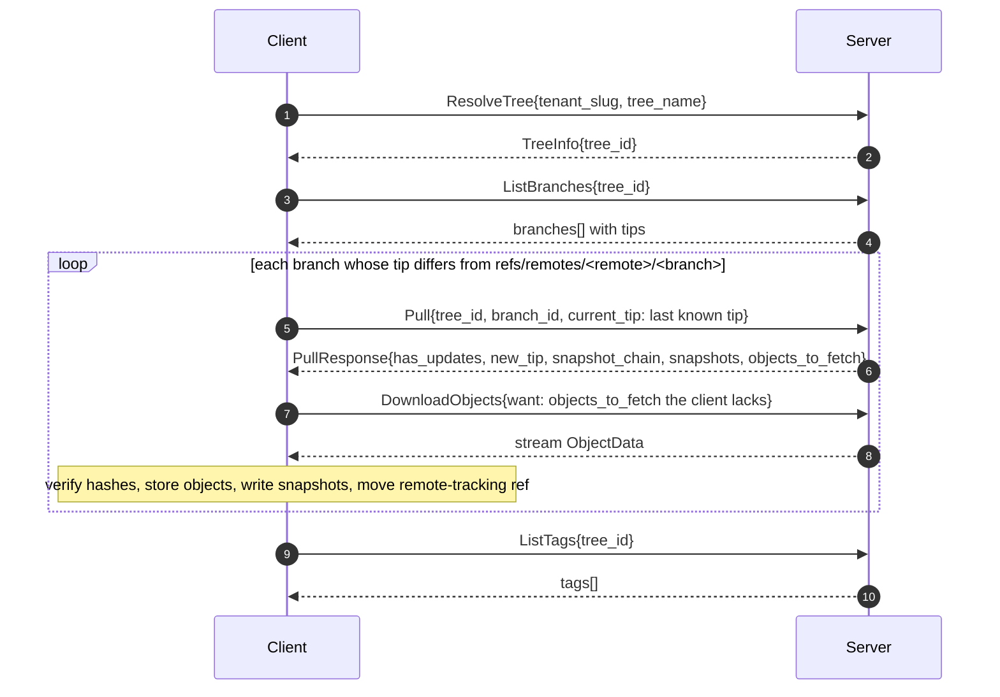
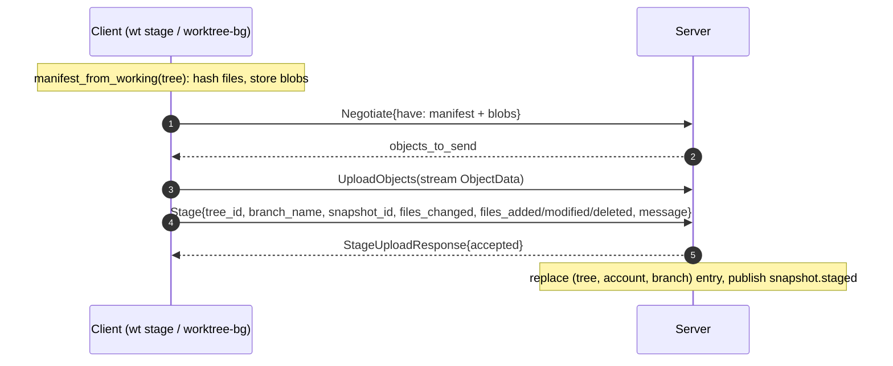

# Sync protocol

The sync protocol is how `wt`, `worktree-bg` and any other `worktree-sdk` client exchange history
with the W0rkTree server. It is defined in
[`crates/worktree-protocol/proto/sync.proto`](../crates/worktree-protocol/proto/sync.proto)
(package `worktree.sync.v1`, service `SyncService`). That file is the Rust ⇄ Go contract; this page
explains how it is used.

- [Transport](#transport)
- [Service](#service)
- [Object model and hashing](#object-model-and-hashing)
- [Flows](#flows): [resolve](#resolving-a-tree), [push](#push), [fetch and pull](#fetch-and-pull), [clone](#clone), [stage](#stage), [tags](#tags), [ping](#ping)
- [Errors and rejections](#errors-and-rejections)
- [Schema conventions](#schema-conventions)

---

## Transport

| Property | Value |
|---|---|
| Protocol | gRPC over HTTP/2 cleartext (h2c) |
| Endpoint | The server base URL, e.g. `http://localhost:7420` — the same listener serves REST, SSE and the admin panel; requests with `content-type: application/grpc*` go to gRPC |
| Max message size | 64 MiB in both directions |
| Authentication | gRPC metadata `authorization: Bearer <token>` |
| Anonymous access | Only `Ping` and read RPCs on `public` trees |

Tokens are obtained over REST (`POST /api/v1/auth/login` or `/register`, see
[server architecture](./server-architecture.md#rest-api)) and stored by the client in
`$WT_HOME/credentials.toml`. A request carrying an invalid token is rejected with `UNAUTHENTICATED`
even for RPCs that allow anonymous access.

The protocol has no built-in encryption. Put a TLS-terminating proxy that supports HTTP/2 in front of
the server for anything beyond local use. Native TLS and QUIC are *Roadmap*.

## Service

| RPC | Request → Response | Permission | Purpose |
|---|---|---|---|
| `Ping` | `PingRequest` → `PingResponse` | none | Server version; account id, username and personal tenant when the token is valid. |
| `ResolveTree` | `ResolveTreeRequest` → `TreeInfo` | `tree:read` (`tree:create` with `create_if_missing`) | Map tenant slug + tree name to a tree id, optionally creating the tree. |
| `ListBranches` | `ListBranchesRequest` → `ListBranchesResponse` | `tree:read` | Branch names, tips, protection flag, update time. |
| `Pull` | `PullRequest` → `PullResponse` | `tree:read` | Snapshots the client is missing on one branch, plus the objects they reference. |
| `Negotiate` | `NegotiateRequest` → `ObjectTransferPlan` | authenticated | Which of the client's candidate (`have`) objects the server lacks. |
| `UploadObjects` | `stream ObjectData` → `UploadObjectsResponse` | authenticated | Upload blobs and manifests; the server verifies every object. Tree-level authorization happens at `Push`/`Stage`, which reference the objects. |
| `DownloadObjects` | `WantMessage` → `stream ObjectData` | `tree:read` with `x-wt-tree-id` metadata, else authenticated | Download objects by hash; unknown hashes are skipped. |
| `Push` | `PushRequest` → `PushResponse` | `tree:write` | Advance a branch to a new tip (fast-forward only). |
| `Stage` | `StageUploadRequest` → `StageUploadResponse` | `tree:write` | Publish a staged (work-in-progress) snapshot. |
| `ListStaged` | `ListStagedRequest` → `ListStagedResponse` | `tree:read` | Team-visible staged snapshots of a tree. |
| `PushTag` | `PushTagRequest` → `PushTagResponse` | `tree:write` | Create a tag on the server. |
| `ListTags` | `ListTagsRequest` → `ListTagsResponse` | `tree:read` | Tags of a tree. |
| `SyncAccessConfig` | `AccessConfigSyncRequest` → `AccessConfigSyncResponse` | `tenant:admin` | Store an access-config document (roles, policies, …). Documents are stored, not evaluated — policy evaluation is *Roadmap*. |

Permissions are evaluated by the server's role matrix and tree visibility; see
[authorization](./server-architecture.md#authorization).

## Object model and hashing

| Concept | Wire form | Identity |
|---|---|---|
| **Blob** | `ObjectData{kind: OBJECT_KIND_BLOB, data}` — raw file bytes | BLAKE3-256 of `data` |
| **Manifest** | `ObjectData{kind: OBJECT_KIND_MANIFEST, data}` — protobuf-encoded `ManifestRecord` | BLAKE3-256 of `data` |
| **Snapshot** | `SnapshotRecord` (not an object) | UUID v4 string in `SnapshotId.value` |
| **Tag** | `TagRecord` | Name, unique per tree |

`ContentHash.value` is always exactly 32 raw bytes. The server recomputes the hash of every uploaded
object and rejects mismatches, so a hash can be trusted wherever it appears.

### Manifests

```proto
message ManifestRecord { repeated ManifestEntry entries = 1; }
message ManifestEntry {
  string path = 1;            // '/'-separated, relative to the tree root
  ContentHash blob_hash = 2;
  uint64 size = 3;
  bool executable = 4;
}
```

Entries are sorted by `path` (byte-wise) and unique, so encoding is canonical: equal file sets
produce byte-identical manifests and equal hashes. The SDK stores the exact same bytes in
`.wt/objects/` and the server in its object store.

### Snapshots

```proto
message SnapshotRecord {
  SnapshotId id = 1;                  // UUID v4
  TreeId tree_id = 2;
  string branch_name = 3;
  repeated SnapshotId parents = 4;    // 0, 1 or 2 (merge); first parent = previous tip
  ContentHash manifest_hash = 5;
  string author = 6;                  // account username or "Name <email>"
  string message = 7;
  google.protobuf.Timestamp created_at = 8;
  bool auto_generated = 9;
}
```

Snapshot records are immutable. Re-sending a known snapshot with identical content is a no-op;
sending a different record under an existing id is an error.

---

## Flows

### Resolving a tree

Every client operation starts by mapping `tenant/tree` (from `[remote.<name>]` and the tree's remote
name) to a server tree id with `ResolveTree`. `push` sets `create_if_missing = true`, which creates
a `private` tree with default branch `main` if the caller holds `tree:create` in the tenant
(`maintainer` or higher; owners of a personal tenant qualify); `TreeInfo.created` reports whether that
happened.

### Object transfer

- **Upload.** `Negotiate.have` carries candidate hashes; `ObjectTransferPlan.objects_to_send` returns
  the subset the server does not store (`total_size` is always 0; `want` is ignored). The client then
  streams those objects with `UploadObjects`. Each object must hash to its `hash`, and a `MANIFEST`
  must decode as a valid `ManifestRecord` (sorted, unique, clean relative paths). Failing objects are
  listed in `rejected` without aborting the stream; `stored` counts objects that were new.
- **Download.** Clients send gRPC metadata `x-wt-tree-id: <tree id>` with `DownloadObjects`. The
  server then requires `tree:read` on that tree (so anonymous downloads from public trees work) and
  only serves objects reachable from the tree's branch tips and tags; other hashes are skipped as if
  unknown. Without the header the caller must be authenticated.

### Push



`snapshot_chain` lists the ids being pushed, oldest first, and `snapshots` carries their full
records in the same order. `old_tip` is the client's last known remote tip; it is advisory — the
server compares against its own tip.

The server accepts the push only if all of the following hold (the first failure wins):

1. The caller is authenticated and holds `tree:write` on the tree, else `AccessDenied`.
2. Branch protection allows a direct push by this caller (`ReviewService.CheckPush`), else
   `BranchProtection` or `ReviewRequired`.
3. Every snapshot record is well-formed, belongs to this tree and does not contradict a stored
   snapshot; every parent is either already stored or included in the request.
4. Every manifest and blob referenced by the new snapshots is present in the object store.
5. `new_tip` descends from the server's current tip, else `ConflictDetected{server_tip}`.
6. The license checker allows the caller's tenant to modify every path that differs between the
   server tip's manifest and `new_tip`'s manifest, else `LicenseViolation{path, license}`.
7. The branch tip is moved with compare-and-swap; losing a race to a concurrent push yields
   `ConflictDetected`.

Re-pushing the current tip succeeds without changes. Pushes are never forced: there is no way to
move a server branch backwards or sideways.

On success the client updates `refs/remotes/<remote>/<branch>` and appends a `push` reflog entry.

### Fetch and pull



`Pull` returns the snapshots reachable from the server tip but not from `current_tip`, oldest first
(parents before children), and `objects_to_fetch` = every manifest and blob hash referenced by them.
`depth` keeps only the newest *N* snapshots (shallow pull). A `current_tip` unknown to the server is
ignored and the full history is sent.

`fetch` stops here: it never touches local branches or the working directory. `pull` additionally
integrates `<remote>/<branch>` into the local branch — fast-forward plus checkout when possible,
otherwise a local three-way merge, which may stop with conflicts (CLI exit code 3).

### Clone

`clone(server, tenant, tree, dest)` = `init` at `dest` → configure `[remote.origin]` → set the local
tree id and remote name to the server's → fetch → create a local branch for every remote branch →
check out the default branch. Public trees can be cloned anonymously.

### Stage



A staged snapshot describes the working state relative to the branch head: the list of changed
paths and add/modify/delete counts. It is never part of branch history. The server keeps at most one
per (tree, account, branch); a successful push of that branch by the same account clears it
(`staged.cleared`). Teammates read them with `ListStaged` (`wt status --team`) or over REST/SSE.

### Tags

Tags are pushed after a successful branch push: the client lists server tags and sends `PushTag` for
each local tag the server lacks. Tag names are unique per tree and tags are immutable on the server.
`fetch` downloads all tags with `ListTags`.

### Ping

`Ping` needs no permissions. With a valid token the response includes `account_id`, `username` and
`tenant_slug` (the personal tenant); `wt whoami` prints them.

---

## Errors and rejections

### Push rejections

A rejected push is a *successful* RPC with `accepted = false` and a `PushRejection`:

| `PushRejection` variant | Cause | Client action |
|---|---|---|
| `ConflictDetected{server_tip}` | The server branch moved; `new_tip` does not descend from it. | `wt pull`, then push again. |
| `BranchProtection{rule}` | A protection rule forbids direct pushes (or the caller is not an allowed pusher). | Push another branch and open a merge request. |
| `AccessDenied{reason}` | The caller lacks `tree:write`. | Ask a tenant admin for the `developer` role or higher. |
| `LicenseViolation{path, license}` | A changed path is covered by a license rule that does not allow the caller's tenant to modify it. | Drop the change to that path. |
| `ReviewRequired{required, current}` | The branch requires approvals. | Use a merge request. |
| `CiChecksFailed{checks}` | Reserved — CI gates are *Roadmap*. | — |
| `QuotaExceeded{limit}` | Reserved — quotas are *Roadmap*. | — |

The SDK turns every rejection into `SdkError::PushRejected` with a readable message; `wt push` exits
with code 1.

### gRPC status codes

| Code | Meaning | SDK error |
|---|---|---|
| `UNAUTHENTICATED` | No or invalid token where one is required. | `NotLoggedIn` |
| `PERMISSION_DENIED` | Authenticated but not allowed (including policy denials outside `Push`). | `PermissionDenied` |
| `NOT_FOUND` | Unknown tenant, tree, branch or snapshot. | `TreeNotFound` (from `ResolveTree`), else `Remote` |
| `ALREADY_EXISTS` | Name already taken (for example a tag). | `Remote` |
| `FAILED_PRECONDITION` | Referenced objects or parent snapshots are missing, a snapshot id was reused with different content, or a concurrent update conflicted. | `Remote` |
| `INVALID_ARGUMENT` | Malformed request (bad id, ref or tree name, wrong hash length). | `Remote` |
| `UNAVAILABLE`, `DEADLINE_EXCEEDED` | Server down or slow. | `Remote` |
| `INTERNAL` | Server bug; details are logged server-side only. | `Remote` |

`UploadObjectsResponse.rejected` lists hashes whose data did not match; the client treats any
rejected object as an error.

---

## Schema conventions

From [`proto/CONVENTIONS.md`](../crates/worktree-protocol/proto/CONVENTIONS.md):

- Every id is a wrapped message (`TreeId`, `SnapshotId`, `BranchId`, `TenantId`, `AccountId`,
  `ContentHash`) for cross-language type safety. `BranchId.value` carries the branch **name**.
- Field tags 100–199 are reserved on every message for additive expansion.
- Timestamps are `google.protobuf.Timestamp`.
- Payload-bearing Rust enums map to `oneof`; unit-only enums map to proto `enum` with
  `_UNSPECIFIED = 0`.
- `SyncEnvelope`, `SyncMessageType` and `SyncState` are kept for parity with the Rust domain types
  and are not used by the gRPC transport.

Changes to `sync.proto` must be additive. Rust bindings are generated by `build.rs` (vendored
`protoc`); regenerate the Go bindings with `bash scripts/gen-proto.sh`.
