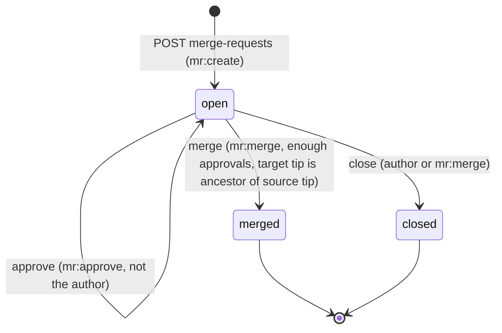

# Server architecture

The W0rkTree server (`services/server-go`, binary `worktree-server`) is the shared source of truth
for trees, branches, snapshots, tags, staged work, merge requests and access control. It is a single
Go 1.25 process with no external dependencies besides its data directory.

- [Process model](#process-model)
- [Packages](#packages)
- [Request flow](#request-flow)
- [Storage](#storage)
- [Authentication](#authentication)
- [Authorization](#authorization)
- [Staged snapshots](#staged-snapshots)
- [Branch protection and merge requests](#branch-protection-and-merge-requests)
- [License enforcement](#license-enforcement)
- [Events and SSE](#events-and-sse)
- [Audit log](#audit-log)
- [REST API](#rest-api)
- [Observability](#observability)
- [Configuration](#configuration)

---

## Process model

```
                    ┌───────────── one TCP listener (default :7420) ─────────────┐
 client ──h2c/h1──► │ content-type: application/grpc*  → gRPC server (SyncService) │
                    │ everything else                  → HTTP mux                  │
                    │     /healthz  /metrics  /api/v1/*  /admin/*                  │
                    └──────────────────────────────────────────────────────────────┘
```

- gRPC (HTTP/2 cleartext, h2c) and HTTP/1.1 + HTTP/2 share one port, so a remote is a single URL such
  as `http://localhost:7420`.
- `GET /` redirects to `/admin/`.
- On startup the server opens `meta.db`, ensures the admin account if `--admin-password` is set, and
  starts listening. On `SIGINT`/`SIGTERM` it shuts down gracefully within `--shutdown-timeout`
  (default 15 s): in-flight requests complete, SSE streams close, the database is closed cleanly.
- The server speaks cleartext. For anything but local use, put a TLS-terminating reverse proxy that
  supports HTTP/2 (h2c upstream) in front of it.

## Packages

Module `github.com/seanfilimon/worktree/services/server-go`. `internal/domain` is the contract: it
holds the data types (`types.go`) and the service interfaces (`interfaces.go`); every other package
implements or consumes those interfaces and never imports a sibling implementation directly.

| Package | Role | Implements |
|---|---|---|
| `main.go` | Entry point: `config.Load(os.Args[1:])` → `server.Run(ctx, cfg)` | — |
| `internal/config` | Flags and environment → `Config` | — |
| `internal/server` | Wires dependencies, h2c mux of gRPC + HTTP, graceful shutdown | — |
| `internal/domain` | Shared types, sentinel errors (`ErrNotFound`, `ErrConflict`, …), interfaces | — |
| `internal/meta` | bbolt metadata store (`NewBolt`), in-memory store for tests (`NewMemory`), ancestry walks (`NewHistory`) | `MetaStore`, `History` |
| `internal/objstore` | Content-addressed object files under `objects/` | `objstore.Store` |
| `internal/hash` | BLAKE3-256 `Hash` type (binary, hex, JSON) | — |
| `internal/iam` | Accounts, passwords, tokens, role matrix; gRPC interceptors and HTTP middleware | `Authenticator`, `Authorizer` |
| `internal/syncsvc` | gRPC `worktree.sync.v1.SyncService` | `syncpb.SyncServiceServer` |
| `internal/httpapi` | REST `/api/v1`, SSE, `/healthz`, `/metrics`, static `/admin/` | `http.Handler` |
| `internal/staged` | Team-visible WIP snapshots | `StagedService` |
| `internal/review` | Branch protection, merge requests | `ReviewService` |
| `internal/license` | Per-path SPDX rules | `LicenseChecker` |
| `internal/audit` | Append-only audit trail | `AuditLog` |
| `internal/events` | In-process pub/sub | `EventBus` |
| `internal/proto/syncpb` | Generated Go bindings for `sync.proto` (`bash scripts/gen-proto.sh`) | — |

Dependency wiring in `internal/server`:

```go
// Simplified; error handling omitted.
store, _ := meta.NewBolt(filepath.Join(cfg.DataDir, "meta.db"))
objects := objstore.New(cfg.DataDir) // objects/<hh>/<62 hex>
hist := meta.NewHistory(store)
iamSvc := iam.New(store, iam.Options{AllowRegistration: cfg.AllowRegistration})
bus := events.NewBus()
auditLog := audit.New(store, logger)
reviewSvc := review.New(store, hist, iamSvc, bus, auditLog)
stagedSvc := staged.New(store, iamSvc, bus)
licenseSvc := license.New(store)

syncSvc := syncsvc.New(syncsvc.Deps{
	Store: store, Objects: objects, History: hist, Authz: iamSvc, Review: reviewSvc,
	License: licenseSvc, Staged: stagedSvc, Bus: bus, Audit: auditLog, Version: version,
})
api := httpapi.New(httpapi.Deps{
	/* the same collaborators, plus: */ Auth: iamSvc, AdminDir: cfg.AdminDir, StartedAt: time.Now(),
})
```

## Request flow

**gRPC** (from `wt`, `worktree-bg`, SDK clients):

1. `iam.UnaryInterceptor` / `iam.StreamInterceptor` read `authorization: Bearer <token>`, resolve it
   with `Authenticator.Authenticate` and attach the `*domain.Principal` to the context
   (`iam.WithPrincipal`). No token → anonymous; invalid token → `UNAUTHENTICATED`.
2. The `syncsvc` handler loads the tenant/tree from `MetaStore` and calls
   `Authorizer.Authorize(ctx, principal, action, tenantID, tree)`.
3. Policy services run as needed: `ReviewService.CheckPush`, `LicenseChecker.CheckPush`,
   `StagedService.Stage`.
4. Data is written to `MetaStore` (branch tips via compare-and-swap) and `objstore`.
5. Side effects: `EventBus.Publish` (e.g. `branch.pushed`), `AuditLog.Record` (e.g. `branch.push`).
6. Domain errors map to gRPC status codes; policy denials on `Push` become `PushRejection` values
   (see [protocol errors](./protocol-spec.md#errors-and-rejections)).

**REST** (from the admin panel, scripts and `wt login`/`register`):

1. `iam.Middleware` attaches the principal from `Authorization: Bearer <token>` (GET requests may
   use an `access_token` query parameter instead, for `EventSource` clients that cannot set headers).
2. `httpapi` routes the request, authorizes it with the same `Authorizer`, calls the domain services
   and writes JSON. Errors use one envelope:

```json
{"error": {"code": "not_found", "message": "tree acme/platform not found"}}
```

| `code` | HTTP status |
|---|---|
| `bad_request` | 400 |
| `unauthenticated` | 401 |
| `forbidden` | 403 |
| `not_found` | 404 |
| `conflict` | 409 |
| `internal` | 500 |

## Storage

Everything lives in the data directory (`--data`, default `./wt-data`):

```text
wt-data/
  meta.db                    bbolt database: all metadata
  objects/<hh>/<62 hex>      content-addressed objects (blobs + manifests)
```

### Metadata (`meta.db`)

`internal/meta.Bolt` implements `domain.MetaStore` on [bbolt](https://github.com/etcd-io/bbolt), a
pure-Go embedded key/value store with serializable transactions. Entities (JSON field names in
`internal/domain/types.go`):

| Entity | Key | Notes |
|---|---|---|
| `Tenant` | id, slug | `kind`: `user` (personal) or `org`; `plan`: `free`/`pro`/`enterprise` (informational). |
| `Account` | id, username | `password_hash` never leaves the server; `is_admin` = server admin; `disabled`. |
| `Membership` | (tenant, account) | One role per account per tenant. |
| `APIToken` | id, sha256 | Only the hex SHA-256 of the raw token is stored. |
| `Tree` | id, (tenant, name) | `visibility`, `default_branch`, `description`. |
| `Branch` | (tree, name) | Tip moved only through `CompareAndSwapBranchTip`. |
| `Snapshot` | id | Immutable; re-writing identical content is a no-op, different content is `ErrConflict`. Adds `pushed_by`, `pushed_at`. |
| `Tag` | (tree, name) | Immutable; a taken name is `ErrAlreadyExists`. |
| `StagedSnapshot` | (tree, account, branch) | Put replaces. |
| `BranchProtection` | (tree, pattern) | |
| `MergeRequest` | (tree, number) | `number` is assigned per tree starting at 1. |
| `LicenseRule` | (tree, path_glob) | |
| `AuditEvent` | time-ordered id | Append-only; no update or delete API. |
| Access config | (tenant, kind) | Raw documents from `SyncAccessConfig`; stored, not evaluated. |

`meta.NewHistory` walks snapshot ancestry for fast-forward checks (`IsAncestor`), logs (`Log`) and
pull computation (`Missing`).

### Objects

`internal/objstore.DiskStore` stores each object at `objects/<first 2 hex>/<remaining 62 hex>` —
the same layout and bytes as a client's `.wt/objects/`. `Put` verifies `BLAKE3(data) == hash`, is a
no-op for existing objects and writes atomically via a temporary file and rename. Objects are
deduplicated across all tenants; access is controlled by the snapshots and trees that reference them,
not by the store. On Windows, a rename onto an existing object can fail with "Access is denied" under
concurrency; because objects are content-addressed this is treated as success.

Back up a server by stopping it (or taking a filesystem snapshot) and copying the whole data directory.

## Authentication

| Mechanism | Details |
|---|---|
| Accounts | `POST /api/v1/auth/register` (if `--allow-registration`) creates an account, a personal tenant with slug = username (kind `user`), and an `owner` membership. |
| Passwords | Hashed with **argon2id** (random salt per hash, PHC string format). Verification is constant-time. |
| Tokens | Bearer tokens look like `wt_<base64url>`, generated from 32 random bytes. The server stores only the hex SHA-256. |
| Sessions | `POST /api/v1/auth/login` issues a session token (default lifetime 30 days); `POST /api/v1/auth/logout` revokes the token used for the call. |
| API tokens | `POST /api/v1/auth/tokens {name, ttl_hours}` issues a named token (shown once); `DELETE /api/v1/auth/tokens/{id}` revokes it. |
| Server admin | `--admin-password` runs `iam.EnsureAdmin`: creates the `--admin-user` account (default `admin`) or resets its password, and sets `is_admin`. |
| Disabled accounts | `PATCH /api/v1/admin/accounts/{username} {"disabled": true}` blocks every action for that account. |

Failed logins are rate-limited per username and client address. Details are in
[security](./security.md#accounts-passwords-and-tokens).

## Authorization

`iam.Service.Authorize(principal, action, tenantID, tree)` decides every request.

1. **Server admins** (`is_admin`) may perform every action, including `server:admin`.
2. **Disabled accounts** may perform none.
3. Otherwise the caller's **role in the tree's tenant** must grant the action.
4. **Tree visibility** can additionally grant `tree:read` to non-members.

### Role matrix

Roles are cumulative: each includes everything of the roles to its left.

| Action | viewer | developer | maintainer | admin | owner |
|---|:-:|:-:|:-:|:-:|:-:|
| `tenant:read` | ✓ | ✓ | ✓ | ✓ | ✓ |
| `tree:read` | ✓ | ✓ | ✓ | ✓ | ✓ |
| `tree:write` (push, stage, tag) | | ✓ | ✓ | ✓ | ✓ |
| `branch:create` | | ✓ | ✓ | ✓ | ✓ |
| `mr:create` | | ✓ | ✓ | ✓ | ✓ |
| `branch:delete` | | | ✓ | ✓ | ✓ |
| `mr:approve` | | | ✓ | ✓ | ✓ |
| `mr:merge` | | | ✓ | ✓ | ✓ |
| `tree:create` | | | ✓ | ✓ | ✓ |
| `tree:admin` (settings, protections, licenses, delete) | | | | ✓ | ✓ |
| `tenant:admin` (members, audit) | | | | ✓ | ✓ |
| `server:admin` | | | | | |

`owner` holds every tenant-level action. `server:admin` is held only by server admins. Membership
roles outside the five built-ins grant nothing.

### Visibility

| Visibility | Anonymous | Any authenticated account | Tenant member |
|---|---|---|---|
| `public` | `tree:read` | `tree:read` | per role |
| `internal` | — | `tree:read` | per role |
| `private` (default) | — | — | per role |

Visibility only ever widens `tree:read`; writing always requires a membership. An anonymous caller
that is refused gets `unauthenticated` (it might succeed after logging in); an authenticated one gets
`forbidden`.

Declarative policies (custom roles, RBAC + ABAC conditions, `.wt-tree/` ceilings) from the
[IAM spec](../crates/worktree-protocol/specs/iam/IAM.md) are *Roadmap*: documents uploaded with
`SyncAccessConfig` are stored but not evaluated.

## Staged snapshots

A staged snapshot is a team-visible record of someone's work in progress: tree, branch, author,
changed paths, add/modify/delete counts, optional message and time. It references a snapshot id
whose manifest and blobs were uploaded, but it is **not** part of branch history.

| Rule | Behavior |
|---|---|
| Create | gRPC `Stage` — requires `tree:write`. Tenant, account, author and time are set by the server. |
| Uniqueness | At most one per (tree, account, branch); a newer stage replaces the older. |
| Read | gRPC `ListStaged`, `GET /api/v1/trees/{tenant}/{tree}/staged?branch=` — requires `tree:read`. Newest first. |
| Clear | A successful push of the branch by the same account clears that account's entry. Entries older than 7 days expire. |
| Events | `snapshot.staged` on stage, `staged.cleared` on clear or expiry. |
| Limits | Up to 10 000 listed paths per upload; the first 1 000 are retained (counts are kept exactly). |

The admin panel and `wt status --team` render this as "who is working on what, right now".

## Branch protection and merge requests

### Protection rules

`BranchProtection{pattern, no_direct_push, required_approvals, allowed_pushers, no_delete}` applies to
every branch whose name matches `pattern`. Patterns use `path.Match` syntax (`*` and `?` do not cross
`/`), extended with `**` as a whole segment (`release/**` matches `release/1.0` and `release/1.x/rc1`).
When several rules match, they combine into the most restrictive result — a rule can only add
restrictions. Protection is never bypassed, not even by server admins.

| Field | Effect |
|---|---|
| `no_direct_push` | Direct pushes are rejected (`BranchProtection`); changes land only through merge requests. |
| `allowed_pushers` | If non-empty, only these usernames may push directly. Empty = role-based only. |
| `required_approvals` | Approvals needed before a merge request into the branch can be merged. |
| `no_delete` | The branch cannot be deleted on the server. The default branch can never be deleted. |

Manage rules with `GET|PUT|DELETE /api/v1/trees/{tenant}/{tree}/protections` (`tree:admin` to change).

### Merge requests

Merge requests are a server-side, **fast-forward-only** workflow:



1. A developer pushes `feature` and opens a merge request `feature → main`. Both branches must exist
   and have snapshots; only one open request per (source, target) pair is allowed.
2. Maintainers approve. Authors cannot approve their own request; approving twice is a no-op.
3. **Merge** moves `main`'s tip to `feature`'s tip with compare-and-swap. It requires `mr:merge` and
   `required_approvals` distinct approvals (else `review_required`, HTTP 403).
4. If `main` has moved and is no longer an ancestor of `feature`, merge fails with `409 conflict`:
   the author runs `wt pull` / `wt merge main` on `feature` locally, pushes, and merges again. The
   server never creates merge snapshots itself.
5. If `main` already contains `feature`'s tip, the request is simply marked merged.

Events: `mr.opened`, `mr.approved`, `mr.merged`, `mr.closed`; audit actions `mr.open`, `mr.approve`,
`mr.merge`, `mr.close`.

## License enforcement

A tree can carry `LicenseRule{path_glob, spdx, grant}` entries
(`GET|PUT|DELETE /api/v1/trees/{tenant}/{tree}/licenses`, `tree:admin` to change). For each path only
the most specific matching rule applies; unmatched paths and trees without rules are unrestricted.

Rules never restrict the tree's **owning tenant**: its members (any role) and server admins have full
rights. Everyone else — accounts from other tenants, anonymous callers — gets the rule's grant:

| Grant | Read | Push changes | Export / redistribute |
|---|:-:|:-:|:-:|
| `read-only` | ✓ | | |
| `modify` | ✓ | ✓ | |
| `redistribute` | ✓ | ✓ | ✓ |
| *(empty)* | proprietary SPDX (`Proprietary`, `LicenseRef-*proprietary*`) → no access; any other license → full rights | | |
| *(unknown value)* | denied (fail closed) | | |

Enforcement points:

- **Push**: `LicenseChecker.CheckPush` runs on every path that differs between the server tip and the
  pushed tip; a violation rejects the push with `LicenseViolation{path, license}`.
- **Read**: `LicenseChecker.CheckRead` guards server endpoints that return file content to the
  caller.

IAM and license checks are independent; an operation needs both to pass.

## Events and SSE

`internal/events.Bus` is an in-process fan-out. `Publish` never blocks: a subscriber that falls behind
drops events rather than slowing the server.

| Event type | Published when |
|---|---|
| `tree.created` | A tree is created (REST or `ResolveTree` with `create_if_missing`) |
| `branch.created` | A branch is created on the server |
| `branch.pushed` | A push advances a branch |
| `tag.pushed` | A tag is created |
| `snapshot.staged` | A staged snapshot is uploaded |
| `staged.cleared` | A staged snapshot is cleared (push or expiry) |
| `mr.opened`, `mr.approved`, `mr.merged`, `mr.closed` | Merge request transitions |

Every event is a `domain.Event`: `{type, tenant_id, tree_id, actor, payload, at}`; `payload` is
type-specific (for example the staged snapshot or the merge request).

Clients subscribe with `GET /api/v1/events?tenant=<slug>&tree=<name>`:

| Filter | Required permission |
|---|---|
| `tenant` + `tree` | `tree:read` on the tree |
| `tenant` only | `tenant:read` on the tenant |
| neither | server admin (all events) |

An optional `types=` parameter takes a comma-separated list of event types.

```bash
curl -N -H "Authorization: Bearer $TOKEN" "http://localhost:7420/api/v1/events?tenant=acme"
```

```text
event: branch.pushed
data: {"type":"branch.pushed","tenant_id":"...","tree_id":"...","actor":"ada","payload":{...},"at":"2026-10-24T12:34:56Z"}

: heartbeat
```

A comment line is sent every 15 seconds to keep proxies from closing idle streams. Events are not
persisted; a reconnecting client should re-read state over REST.

## Audit log

`internal/audit.Log` records security-relevant actions as `AuditEvent{id, tenant_id, actor_id, actor,
action, resource_type, resource_id, details, remote_addr, at}` in `meta.db`. The log is append-only:
there is no API to modify or delete entries. Recording never fails the original request (storage
errors are logged), ids are time-ordered, and detail values whose keys look sensitive (`password`,
`token`, `secret`, …) are redacted.

Recorded actions include `auth.register`, `auth.login`, `auth.login_failed`, `auth.logout`,
`token.create`, `token.revoke`, `tenant.create`, `member.update`, `member.remove`, `tree.create`,
`tree.update`, `tree.delete`, `branch.push`, `branch.push_rejected`, `tag.push`,
`protection.update`, `protection.delete`, `license.update`, `license.delete`, `mr.open`,
`mr.approve`, `mr.merge`, `mr.close`, `account.update`, `access_config.sync`.

Query with `GET /api/v1/audit?tenant=<slug>&action=<action>&limit=<n>` (newest first). Tenant admins
see their tenant; server admins see everything.

## REST API

Base path `/api/v1`, JSON bodies, `Authorization: Bearer <token>`. JSON field names are exactly the
`json` tags in [`internal/domain/types.go`](../services/server-go/internal/domain/types.go). CORS allows
`http://localhost:5173` (Vite dev server) plus `--cors-origins`.

### Health and metrics (no `/api/v1` prefix)

| Method | Path | Response |
|---|---|---|
| GET | `/healthz` | `{"status":"ok","version":"…","uptime_seconds":N}` |
| GET | `/metrics` | Prometheus text format |

### Auth

| Method | Path | Body | Response |
|---|---|---|---|
| POST | `/auth/register` | `{username, email, password}` | `201 {token, account}` |
| POST | `/auth/login` | `{username, password}` | `{token, account}` |
| POST | `/auth/logout` | — | `204`; revokes the current token |
| GET | `/auth/me` | — | `{account, memberships: [{tenant, role}]}` |
| GET | `/auth/tokens` | — | `[api_token]` |
| POST | `/auth/tokens` | `{name, ttl_hours}` | `{token, api_token}` — the raw token is returned once |
| DELETE | `/auth/tokens/{id}` | — | `204` |

### Tenants and members

| Method | Path | Body | Response | Permission |
|---|---|---|---|---|
| GET | `/tenants` | — | `[tenant]` visible to the caller | authenticated |
| POST | `/tenants` | `{slug, name}` | `201 tenant` (kind `org`, caller becomes `owner`) | authenticated |
| GET | `/tenants/{tenant}` | — | `tenant` | `tenant:read` |
| GET | `/tenants/{tenant}/members` | — | `[{account: {id, username, …}, role}]` | `tenant:read` |
| PUT | `/tenants/{tenant}/members/{username}` | `{role}` | `member` | `tenant:admin` |
| DELETE | `/tenants/{tenant}/members/{username}` | — | `204` | `tenant:admin` |
| GET | `/tenants/{tenant}/trees` | — | `[treeSummary]` (readable trees only) | `tree:read` per tree |
| POST | `/tenants/{tenant}/trees` | `{name, description, visibility, default_branch}` | `201 tree` | `tree:create` |

`{tenant}` is the tenant slug.

### Trees

All paths below are under `/trees/{tenant}/{tree}`.

| Method | Path | Body / query | Response | Permission |
|---|---|---|---|---|
| GET | *(tree)* | — | `treeSummary {tree, branch_count, snapshot_count, staged_count, open_mr_count}` | `tree:read` |
| PATCH | *(tree)* | `{description?, visibility?, default_branch?}` | `tree` | `tree:admin` |
| DELETE | *(tree)* | — | `204` | `tree:admin` |
| GET | `/branches` | — | `[branch]` | `tree:read` |
| GET | `/snapshots` | `?branch=&limit=50` | `[snapshot]`, newest first | `tree:read` |
| GET | `/snapshots/{id}` | — | `{snapshot, files: [{path, hash, size, executable}]}` | `tree:read` |
| GET | `/blob/{snapshot}/{path...}` | — | raw file bytes | `tree:read` (+ license read check) |
| GET | `/tags` | — | `[tag]` | `tree:read` |
| GET | `/staged` | `?branch=` | `[staged]` | `tree:read` |
| GET | `/protections` | — | `[protection]` | `tree:read` |
| PUT | `/protections` | `BranchProtection` | `protection` | `tree:admin` |
| DELETE | `/protections` | `?pattern=` | `204` | `tree:admin` |
| GET | `/licenses` | — | `[license_rule]` | `tree:read` |
| PUT | `/licenses` | `LicenseRule` | `license_rule` | `tree:admin` |
| DELETE | `/licenses` | `?path_glob=` | `204` | `tree:admin` |
| GET | `/merge-requests` | `?state=open\|merged\|closed` | `[mr]` | `tree:read` |
| POST | `/merge-requests` | `{title, description, source_branch, target_branch}` | `201 mr` | `mr:create` |
| GET | `/merge-requests/{n}` | — | `mr` | `tree:read` |
| POST | `/merge-requests/{n}/approve` | — | `mr` | `mr:approve` |
| POST | `/merge-requests/{n}/merge` | — | `mr`; `409` if a local merge is needed | `mr:merge` |
| POST | `/merge-requests/{n}/close` | — | `mr` | author or `mr:merge` |

### Audit, events, administration

| Method | Path | Response | Permission |
|---|---|---|---|
| GET | `/audit?tenant=&action=&limit=` | `[audit_event]` | tenant admin or server admin |
| GET | `/events?tenant=&tree=` | `text/event-stream` | read access to the filtered scope |
| GET | `/admin/stats` | `ServerStats {tenants, accounts, trees, branches, snapshots, staged, objects, storage_bytes}` | server admin |
| GET | `/admin/accounts` | `[account]` | server admin |
| PATCH | `/admin/accounts/{username}` | `{is_admin?, disabled?}` → `account` | server admin |
| GET | `/admin/*` (no `/api/v1` prefix) | Static admin SPA with `index.html` fallback | public |

Example session:

```bash
TOKEN=$(curl -s -X POST http://localhost:7420/api/v1/auth/login \
  -H 'content-type: application/json' \
  -d '{"username":"ada","password":"secret-pass"}' | jq -r .token)

curl -s -H "Authorization: Bearer $TOKEN" http://localhost:7420/api/v1/tenants/acme/trees | jq
curl -s -H "Authorization: Bearer $TOKEN" \
  "http://localhost:7420/api/v1/trees/acme/platform/snapshots?branch=main&limit=5" | jq '.[].message'
```

## Observability

- `GET /healthz` for liveness/readiness probes.
- `GET /metrics` in Prometheus text format (request counters and latencies, server stats).
- Structured logs (`log/slog`) on stderr: `--log-level`, `--log-format text|json`.
- `GET /api/v1/admin/stats` and the admin dashboard for object counts and storage size.

## Configuration

Flags and environment variables are listed in [configuration](./configuration.md#server-flags-and-environment).
